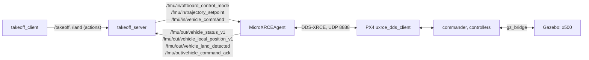

# Week 6: PX4 SITL, uXRCE-DDS and a takeoff action

Skill booster 5 from UAVs@Berkeley Software Ground School (optional). Setup notes and every problem hit on the way are in [`docs/week06/NOTES.md`](../docs/week06/NOTES.md); every measurement below is in [`docs/week06/RESULTS.md`](../docs/week06/RESULTS.md); the showcase page is [uav-ground-school.pages.dev/week6](https://uav-ground-school.pages.dev/week6).

> Make sure you have ROS running properly on your machine. Set up PX4 SITL with Gazebo. Set up XRCE-DDS to enable interfacing between ROS 2 and the simulated PX4 flight controller. Implement an action server that takes off the drone to, say, 5 meters. Test it by implementing an action client that sends that request!

All four, on an 8 GB Apple M1, with nothing installed on the Mac but Docker:

1. **ROS 2 Jazzy**, in week 5's image.
2. **PX4 v1.17.0 SITL with Gazebo Harmonic**, built from source in [`ros2_ws/px4/Dockerfile`](../ros2_ws/px4/Dockerfile) by PX4's own setup script, flying the `gz_x500` quadcopter headless.
3. **uXRCE-DDS**: the Micro XRCE-DDS Agent v2.4.3 and px4_msgs v1.17.0, the versions the PX4 ROS 2 guide pairs with Jazzy. `ros2 topic list` shows PX4's `/fmu/in` and `/fmu/out` topics.
4. **The action server and client** in [`ros2_ws/src/ugs_px4`](../ros2_ws/src/ugs_px4): `/takeoff` climbs to the goal's altitude and holds it, with 10 Hz feedback, a result and cancel; `/land` brings it back. The client asks for 5 m. In PX4 SITL the x500 held **5.03 m** (5.06 m by Gazebo's true pose), rising in **4.0 s** with **6 cm** of overshoot.

Then the week goes further:

* **Two ways to take off, both measured**: offboard control (the server streams a trapezoidal setpoint profile) and PX4's own takeoff mode (one command, PX4 flies the climb).
* **Every failure path tested**: a fake PX4 that follows the commander's rules (no offboard without a setpoint stream, no arming before the preflight checks, hold one second after the setpoints stop) runs under six launch tests and 29 unit tests: refusals, a pilot taking over, losing the link, cancel.
* **Measured against ground truth**: Gazebo's true pose against PX4's estimate.
* **DDS-XRCE from the specification**, in pure Python: a dissector that rebuilds PX4's session with the agent from a capture, and a client that logs in to the agent itself and flies the same takeoff with **no ROS 2 at all**.

* [Running it](#running-it)
* [The action](#the-action)
* [The flights](#the-flights)
* [DDS-XRCE by hand](#dds-xrce-by-hand)
* [Tests](#tests)

## Running it

```bash
python -m week06 docker build             # once: ugs-ros:jazzy, then ugs-px4:jazzy (about an hour)
python -m week06 fly                      # PX4 + Gazebo + agent + server + client: 5 m, hover, land
python -m week06 fly --altitude 10 --climb-rate 2
python -m week06 fly --method takeoff_mode
python -m week06 fly --cancel-after 4     # cancel 4 s after lift off
python -m week06 fly --xrce               # the same takeoff from pure Python, no ROS 2
python -m week06 analyze docs/week06/flights/offboard_5m.jsonl
python -m week06 docker test              # colcon build and test, ugs_px4 included
python -m week06 docs --sitl              # refly everything, regenerate docs/week06
```

Inside the container, or on Ubuntu 24.04 with ROS 2 Jazzy and the PX4 guides' setup done:

```bash
ros2 launch ugs_px4 sitl.launch.py                  # agent, PX4 SITL, Gazebo, server, client
ros2 launch ugs_px4 sitl.launch.py flight:=false    # just PX4, Gazebo and the agent, then:
ros2 run ugs_px4 takeoff_server
ros2 run ugs_px4 takeoff_client 5 --hover 5 --land
ros2 action send_goal /takeoff ugs_interfaces/action/Takeoff "{altitude: 5.0}" --feedback
ros2 launch ugs_px4 takeoff.launch.py fake:=true    # against the fake PX4, no simulator
```

## The action



[`Takeoff.action`](../ros2_ws/src/ugs_interfaces/action/Takeoff.action) and [`Land.action`](../ros2_ws/src/ugs_interfaces/action/Land.action) live beside week 5's `FlyToWaypoint`:

```text
float32 altitude        # goal: metres above the takeoff point
float32 climb_rate      # m/s; 0 uses the server's default
string method           # "offboard" (default) or "takeoff_mode"
---
bool success            # result
float32 final_altitude
float32 climb_time
string message
---
string phase            # feedback: WAIT_FOR_PX4, PREFLIGHT, OFFBOARD, ARMING, CLIMB, SETTLE
float32 altitude
float32 vertical_speed
float32 remaining
```

The server ([`takeoff_server.py`](../ros2_ws/src/ugs_px4/ugs_px4/takeoff_server.py)) is thin: it gathers PX4's telemetry into a snapshot, runs [`takeoff.py`](../ros2_ws/src/ugs_px4/ugs_px4/takeoff.py) at 20 Hz, and publishes whatever that asks for. `takeoff.py` has no ROS in it, which is what lets the same code be unit tested, run against the fake PX4, fly PX4 SITL, run in the browser (ported line for line), and fly over pure Python XRCE.

| Phase | Offboard | Takeoff mode |
| --- | --- | --- |
| `WAIT_FOR_PX4` | until status and a valid local position arrive | same |
| `PREFLIGHT` | stream a hold setpoint; wait for `pre_flight_checks_pass` (60 s at most) | wait for the checks |
| `OFFBOARD` / `TAKEOFF_MODE` | after 1 s of setpoints, `DO_SET_MODE` (custom mode 6) until PX4 is in offboard | `NAV_TAKEOFF` to the AMSL altitude until PX4 is in takeoff mode |
| `ARMING` | `COMPONENT_ARM_DISARM` until armed | same |
| `CLIMB` | follow a trapezoidal profile: 1 m/s² up to the climb rate, cruise, brake | PX4 climbs at `MPC_TKO_SPEED` |
| `SETTLE` | within 0.15 m and 0.15 m/s for 1 s: succeed, keep holding | PX4 switches to hold; same test |

Every command is resent each second until PX4's state shows it worked, and the goal aborts after five tries with PX4's last acknowledgement in the message. The goal also aborts if PX4 leaves the mode (a failsafe or a pilot), disarms, or goes quiet for a second. Cancel holds the altitude reached (offboard) or switches to hold (takeoff mode). Goals outside 1 to 120 m, climb rates above 3 m/s, unknown methods and second concurrent goals are rejected before anything reaches PX4. Between goals the server keeps streaming its last setpoint, because PX4 treats a silent offboard link as a failsafe.

## The flights

Flown in the M1's container, recorded by `flight_recorder` (both directions of the PX4 link, the action's feedback and status, every log line) and Gazebo's true pose, measured by [`week06/flight.py`](flight.py):

| Flight | Result | Peak | Rise, 10 to 90 % | Max climb | Overshoot | Settled | Hover error, RMS | Tracking, RMS | Landed |
| --- | --- | ---: | ---: | ---: | ---: | ---: | ---: | ---: | --- |
| Offboard, 5 m | succeeded | 5.06 m | 3.98 s | 1.21 m/s | 0.06 m | 5.8 s | 0.046 m | 0.30 m | yes |
| Offboard, 5 m, reference on a fixed clock | succeeded | 4.99 m | 2.40 s | 2.57 m/s | 0.00 m | 4.5 s | 0.047 m | 1.22 m | yes |
| Takeoff mode, 5 m | succeeded | 5.00 m | 4.40 s | 1.27 m/s | 0.00 m | 6.3 s | 0.045 m | n/a | yes |
| Offboard, 10 m at 2 m/s | succeeded | 9.98 m | 4.17 s | 2.12 m/s | 0.00 m | 6.1 s | 0.058 m | 0.25 m | yes |
| Canceled 4 s after lift off | canceled at 4.40 m | 4.53 m | n/a | 1.06 m/s | 0.00 m | n/a | n/a | 0.28 m | yes |
| Pure Python over XRCE, 5 m | succeeded | 5.01 m | 4.03 s | 1.22 m/s | 0.01 m | 6.7 s | 0.038 m | 0.31 m | yes |

Times are simulated seconds (PX4's clock): PX4 SITL runs in lockstep with Gazebo, and the M1 ran the simulation at down to half real time in the busiest flights, so `week06/flight.py` restamps every record through `vehicle_local_position`'s timestamps.

* **The assignment** (offboard, 5 m): PX4 held **5.03 m** by its own estimate, **5.06 m** by Gazebo's true pose, rising in 3.98 s with 6 cm of overshoot and settling inside 0.25 m 5.8 s after lift off. Over the whole flight PX4's altitude estimate was 0.09 m RMS from the truth (0.15 m at worst); in an earlier batch of flights, since reflown with the final code, the estimate read 0.17 m high in the hover, so expect the barometer driven estimate to wander by about that much. It drifted 7 cm sideways.
* **Why the reference waits**: PX4 spends about 3 s after arming spooling the motors up and ramping its takeoff (2.8 s here). With the reference on a fixed clock (`--max-lead 0`), the setpoint was metres up before the x500 left the ground, and PX4 chased it at **2.57 m/s**, more than twice the 1 m/s asked for, 1.22 m RMS behind. With the reference held to 0.4 m ahead of the vehicle: 1.21 m/s and 0.30 m.
* **PX4's takeoff mode** climbs on its own ramp at `MPC_TKO_SPEED` and settles more slowly (6.3 s), but needs no setpoint stream at all.
* **10 m at 2 m/s**: peak climb 2.12 m/s, no overshoot.
* **Cancel** 4 s after lift off: the server held the altitude it was canceled at (4.40 m), coasting 13 cm while braking and holding to 11 cm RMS, then `/land` brought it down.
* **No ROS 2**: the same state machine over this repo's XRCE client: rise 4.03 s, max climb 1.22 m/s, hover error 3.8 cm RMS, within noise of the ROS 2 flight.

## DDS-XRCE by hand

PX4 does not speak DDS: its `uxrce_dds_client` speaks DDS-XRCE to the agent, which creates real DDS entities on its behalf. [`week06/xrce.py`](xrce.py) implements the protocol from the OMG DDS-XRCE 1.0 specification and eProsima's binary object representations: message and submessage headers, streams, CREATE_CLIENT and STATUS_AGENT, CREATE for participants, topics, publishers, subscribers, writers and readers, STATUS, READ_DATA, WRITE_DATA and DATA, HEARTBEAT and ACKNACK, FRAGMENT, and timestamps.

The 5 m flight's capture, dissected by `python -m week06 xrce session` (43 s): PX4 found the agent with GET_INFO, logged in with client key `00000001` (MTU 508), synchronized clocks with a stream of TIMESTAMP and TIMESTAMP_REPLY, then created **197 objects** in one participant: 65 topics, each with its publisher and writer (`/fmu/out`) or subscriber and reader (`/fmu/in`), plus a replier for the `vehicle_command` service. 17,157 submessages in all, every one decoded, and every sample decoded to px4_msgs' field names with week 5's CDR. 22 topics carried data; PX4 sent 324 kbit/s and received 33 kbit/s. Every `/fmu/out` writer is best effort and transient local, which is why a default ROS 2 subscription hears nothing.

```console
$ python -m week06 xrce decode docs/week06/flights/offboard_5m.xrce.pcap
   0.0000  px4>agent  [none #0]  GET_INFO
   0.0393  agent>px4  [none #0]  INFO
   0.0394  px4>agent  [none #0]  CREATE_CLIENT key 00000001 session 0x81 mtu 508
   0.0443  agent>px4  [none #0]  STATUS_AGENT OK (XRCE 0100, vendor 010f)
   0.0443  px4>agent  [reliable 128 #0]  CREATE #10 participant 1
   0.1182  agent>px4  [reliable 128 #0]  STATUS #10 participant 1: OK
   ...
   6.5297  px4>agent  [reliable 128 #60]  CREATE #226 topic 288 rt/fmu/out/vehicle_status_v1 type px4_msgs::msg::dds_::VehicleStatus_
   6.5419  px4>agent  [best effort 1 #16]  WRITE_DATA /fmu/out/vehicle_status_v1 (80 bytes): timestamp=1792533259971477, armed_time=0, takeoff_time=0, arming_state=1, ...
   6.6168  agent>px4  [best effort 1 #1]  DATA /fmu/in/trajectory_setpoint (64 bytes): timestamp=1792533260178643, position=[-0.013, 0.016, -0.001], velocity=[nan, nan, nan], ...
```

[`week06/xrce_client.py`](xrce_client.py) is the other half: it logs in to the agent as a second client and creates topics, readers and writers the same way PX4 does. `python -m week06 xrce echo` reads any PX4 topic with no ROS 2, and `python -m week06 xrce fly` flew the takeoff and landing above with seven topics of its own; PX4 cannot tell it from the ROS 2 server.

## Tests

| Where | What |
| --- | --- |
| [`tests/test_week06_takeoff.py`](../tests/test_week06_takeoff.py) | 29 tests of the logic against the PX4 model: both methods, climb rate, the profile, a goal while flying, every refusal, offboard loss, takeover, telemetry loss, timeouts, cancel, landing |
| [`tests/test_week06_flight.py`](../tests/test_week06_flight.py) | the measurements on a model flight with exact answers, truth alignment, and every committed SITL flight |
| [`tests/test_week06_xrce.py`](../tests/test_week06_xrce.py) | the XRCE codec: object ids, headers, every payload this repo encodes, alignment, truncation |
| [`tests/test_week06_dissect.py`](../tests/test_week06_dissect.py) | the dissector on a synthetic session (fragments included) and on the real capture of PX4's session |
| [`ugs_px4/test`](../ros2_ws/src/ugs_px4/test) | six launch tests with `fake_px4`, the px4_msgs constants, and ament's flake8, pep257 and copyright |
| [`tests/test_site.py`](../tests/test_site.py) | the page's JavaScript port of the logic and the model against Python, identical traces on 9 scenarios |
| [`px4-sitl.yml`](../.github/workflows/px4-sitl.yml) | builds the image on GitHub's runners and flies offboard, takeoff mode and pure Python XRCE in real PX4 SITL |

The packages are Apache 2.0 like week 5's; the bundled px4_msgs definitions are BSD 3-Clause (see [`interfaces/README.md`](interfaces/README.md)); the rest is MIT.
